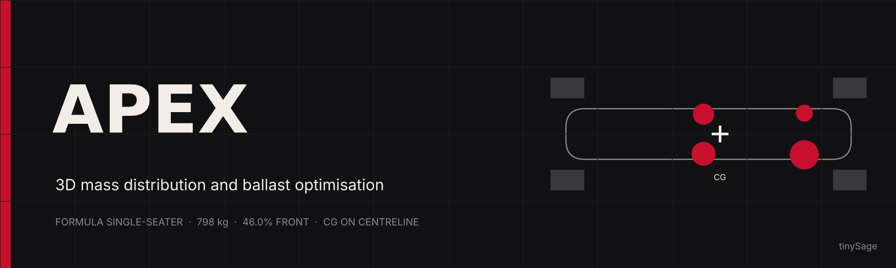
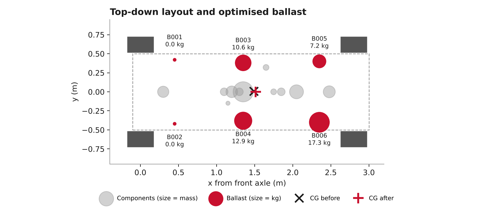
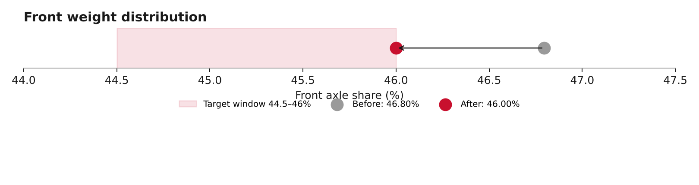
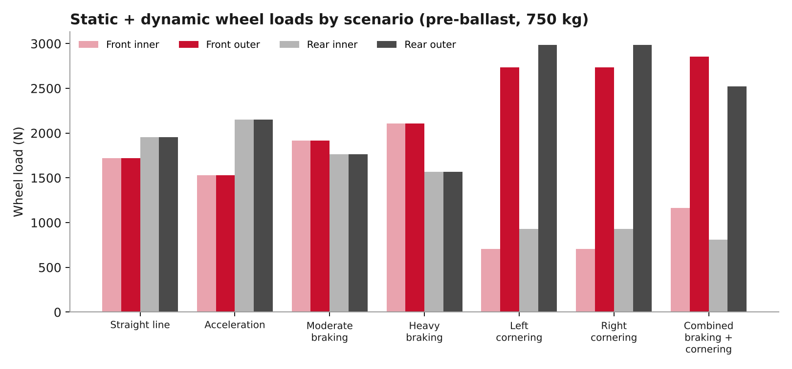

# APEX · ballast and load results

Results export from the APEX ballast optimiser for a formula single-seater. The car comes in at 750 kg and has to reach the 798 kg minimum. The optimiser places the missing 48 kg across six ballast stations so the front axle share lands inside the 44.5–46% window and the CG sits on the centreline.

> Every input here (component masses, positions, station geometry) is a synthetic assumption, and no station is marked `safety_verified`. Treat the numbers as a worked example of the method.



## Result

| | Before | After | Target |
|---|---|---|---|
| Total mass (kg) | 750.0 | 798.0 | 798 |
| Front axle (%) | 46.80 | **46.00** | 44.5–46 |
| CG X (m) | 1.490 | 1.512 | |
| CG Y (m) | 0.0065 | -0.0000 | 0 |
| CG Z (m) | 0.361 | 0.351 | lower is better |
| Yaw inertia (kg·m²) | 253.4 | 278.9 | |



The front share drops from 46.80% to 46.00%, which is the upper edge of the window. The front stations stay empty and the mass goes mid and rear. The right side gets more than the left (B004 > B003, B006 > B005) to cancel the 6.5 mm left offset from the cooling system. Because the stations sit low (z ≈ 0.2 m), the CG also drops by about 10 mm.

| Station | Name | x (m) | y (m) | Ballast (kg) |
|---|---|---|---|---|
| B001 | Front Left | 0.45 | 0.42 | 0.00 |
| B002 | Front Right | 0.45 | -0.42 | 0.00 |
| B003 | Mid Left | 1.35 | 0.38 | 10.63 |
| B004 | Mid Right | 1.35 | -0.38 | 12.89 |
| B005 | Rear Left | 2.35 | 0.4 | 7.19 |
| B006 | Rear Right | 2.35 | -0.4 | 17.29 |

## Dynamic scenarios

Wheel loads for seven manoeuvres, computed on the 750 kg pre-ballast car. No scenario lifts a wheel. The tightest case is combined braking and cornering, where the rear inner wheel drops to about 706 N.



| Scenario | Longitudinal (m/s²) | Lateral (m/s²) | Minimum wheel load (N) | Wheel lift |
|---|---|---|---|---|
| Straight line | 0.0 | 0.0 | 1,721 | no |
| Acceleration | 4.0 | 0.0 | 1,528 | no |
| Moderate braking | -4.0 | 0.0 | 1,763 | no |
| Heavy braking | -8.0 | 0.0 | 1,570 | no |
| Left cornering | 0.0 | 12.0 | 706 | no |
| Right cornering | 0.0 | -12.0 | 706 | no |
| Combined braking and cornering | -6.0 | 10.0 | 810 | no |

## How it works

The full pipeline lives in [`notebooks/APEX.ipynb`](notebooks/APEX.ipynb) [](https://colab.research.google.com/github/tinySage/APEX_Engineering_Results/blob/main/notebooks/APEX.ipynb).

1. Vehicle model: 11 component groups and 6 ballast stations, each with a 3D position and mass, validated on load.
2. Mass properties: total mass, 3D CG, yaw inertia and static axle loads, checked against an independent calculation.
3. Ballast optimisation: SciPy constrained solver that hits the minimum mass, keeps the front share in the target window and centres the CG, with a multi-start robustness check.
4. Dynamic analysis: longitudinal and lateral load transfer per wheel across seven manoeuvres, with wheel-lift detection.
5. Interactive simulator: ipywidgets dashboard for moving stations, editing ballast and re-running the optimiser live.
6. Export: writes the CSVs and the Excel workbook in this repo.

To run locally:

```
pip install -r requirements.txt
jupyter notebook notebooks/APEX.ipynb
```

The last cell uses `google.colab` to download the results zip and only works in Colab.

## Files

```
notebooks/
  APEX.ipynb               model, optimiser, dynamics and export
data/
  vehicle_components.csv   mass and position of the 11 component groups
  ballast_stations.csv     station geometry, limits and flags
  ballast_current.csv      ballast as delivered (all zero)
  ballast_optimised.csv    optimiser output, kg per station
  dynamic_scenarios.csv    axle and wheel loads per manoeuvre
report/
  APEX_Engineering_Report.xlsx   formatted workbook with summary, ballast plan and charts
figures/                   PNGs used in this README
```

Coordinates: x runs rearward from the front axle, y is positive to the left, z is up from the ground. The 2.80 m wheelbase is inferred from the exported CG and axle split.

Exported 2026-11-01.

## Licence

[MIT](LICENSE) © 2026 Muktanan Mohapatra
